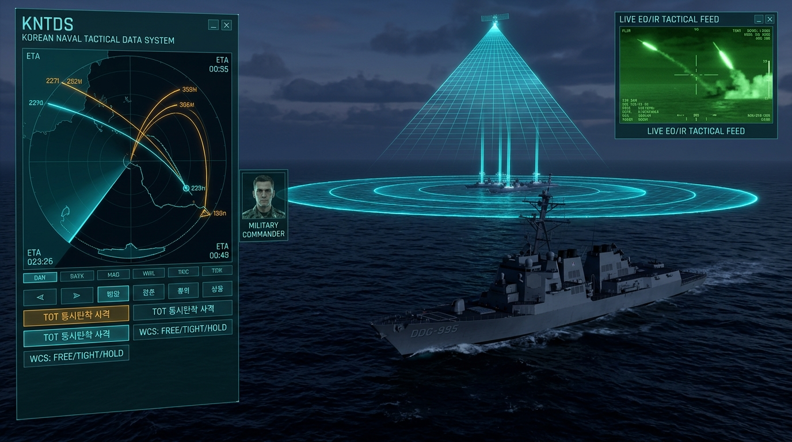
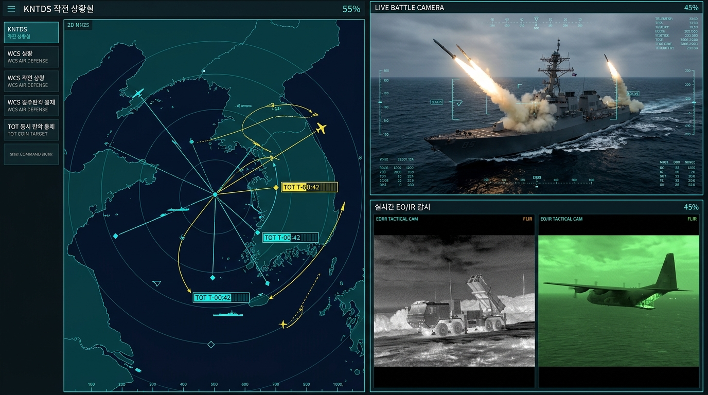
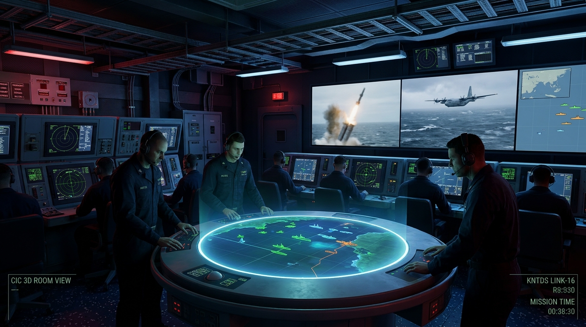

# Steel Tide · 지휘통제실(KNTDS CIC) 개선 방안 시각화 (원본 시안)

현재 [cic.js](../../app/public/js/cic.js)의 `#cic`는 좌측 미니 상황판 + 외부 지원 호출 위주로 구성되어 있어, 3D 전장 상의 시각적 임팩트와 함대 교전(방공·함포·미사일 유도)과의 유기적 역할 분리가 약하다는 피드백이 있었습니다. 아래 **3가지 개선 시안**은 Claude 인수인계용 원본 설계 및 목업입니다.

---

## 시안 A. 작전 피드 + 3D 홀로그램 스캔 연출 (1차 구현 대상 · 시각 임팩트 보강 필요)

- **핵심 컨셉**: 기존 3D 전장 화면과 좌측 KNTDS 패널 배치를 유지하면서 **시각 피드백 + 전술 고유 역할**만 고밀도로 추가.
- **3D 시각 요소**:
  - **위성·ISR 정찰**: 지정 해역 `11 km` 위를 **동심원 홀로그램 링 + 궤도 위성 와이어프레임 스캔 피라미드 + 수직 Link-16 타겟 빔**이 쓸고 지나가며, 포착된 적함 위로 30초간 정밀 표적 빔 투사.
  - **EO/IR 작전 생중계 창(우측 상단)**: `해안포대`·`C-130H`·`정찰`·`TOT` 승인 시 우측 상단에 고대비 녹색 FLIR 열상 PiP 모니터가 자동 팝업되어 실제 발사·투하·피격 장면을 실시간 중계.
- **KNTDS & 고유 전술**: **곡선(Bezier) 비행 궤적 호 + ETA 카운트다운**, **TOT 동시 탄착 사격**(본함+호위함+해안포/공군 시차 발사 → 동시 도달), **방공 WCS 통제(`FREE / TIGHT / HOLD`)**, 적 미사일 우선 요격 지정.

---

## 시안 B. 반화면 전술 상황실 데스크 (Tactical Desk 55:45)

- **핵심 컨셉**: `` ` `` 또는 `Shift+\`` 키로 지휘통제실을 열면 **"작전 상황실 화면"**으로 전환되어 좌측 55%에 대형 KNTDS 전술도, 우측 45%에 실시간 3D 전투 카메라 + 하단 2분할 EO/IR 감시 모니터 배치.
- **시각 요소**:
  - 대형 상황판 위에서 **TOT 카운트다운 게이지**, **미사일 비행 궤적 호(Arc)**, **Link-16 교전선**을 한눈에 조망.
  - 우측 하단 2개의 FLIR/EO·IR 창에서 **해안 지대함 포대 발사**와 **C-130H 후방 램프 투하 / 미사일 비행**을 동시에 관제.

---

## 시안 C. 3D 함내 지휘통제실(CIC) 인테리어 시점

- **핵심 컨셉**: 전투기 1인칭 조종석(`jetPit`)처럼 함선 내부 **3D 지휘통제실 룸**으로 들어가, 중앙 홀로그램 작전 테이블과 벽면 대형 EO/IR 스크린으로 전투를 지휘.
- **시각 요소**:
  - 중앙 원형 홀로그램 테이블 위에 **실시간 3D 지형·아군/적군 함정 미니어처·미사일 궤적·위성 스캔 링** 투사.
  - 전면 대형 월 스크린에 실시간 VLS 발사 영상과 C-130H 접근 영상을 동시 송출.

---

### 권장 실행 전략
1. **시안 A**의 시각적 완성도(다중 3D 홀로그램 스캔 링·위성 스캔 콘·고대비 FLIR PiP·KNTDS 대형 상황판 및 곡선 궤적 호)를 목업 수준으로 끌어올립니다.
2. 이어서 ``Shift+` `` 확대 모드를 **시안 B (55:45 Tactical Desk + 하단 듀얼 EO/IR 모니터)**로 업그레이드합니다.
3. 이후 필요 시 `ovScene` 또는 전용 씬으로 **시안 C (3D 함내 CIC 인테리어 시점)**를 추가 모드로 확장합니다.
