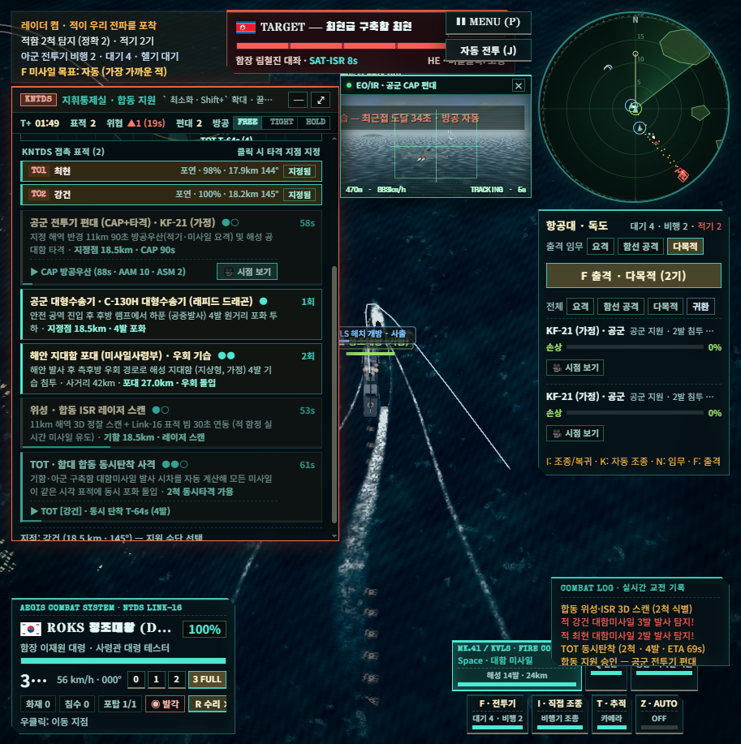
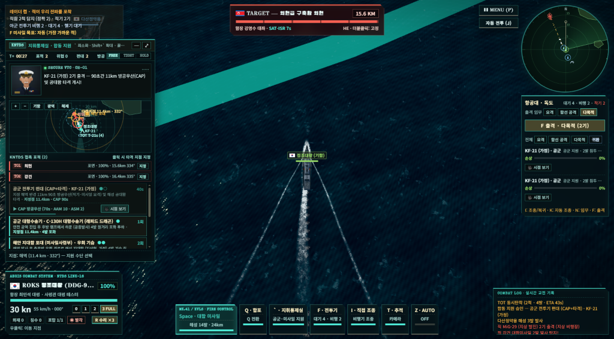

# Claude Code 인수인계 문서 · Steel Tide 지휘통제실(CIC) 업그레이드

작성 시점 기준 저장소 `HEAD`: `ecf3e16` (`origin/main`, 남태평양 지형 업그레이드 포함).  
지휘통제실 시안 A의 1차 구현 커밋은 `513c707`이며, 사용자는 **시안의 시각적 임팩트와 실전 체감이 아직 기대에 못 미친다**고 판단하여 본 문서와 이미지를 통해 Claude에게 후속 완성/고도화를 인수인계합니다.

---

## 1. 첨부 이미지 목록 (`./images/`)

| 파일 | 설명 |
| --- | --- |
| [`cic_option_a_proposal.jpg`](./images/cic_option_a_proposal.jpg) | **시안 A 목업** — 좌측 KNTDS(곡선 미사일 궤적 호 + ETA), 바다 위 다중 시안 홀로그램 링 + 위성 스캔 피라미드 + 수직 Link-16 빔, 우상단 녹색 FLIR `LIVE EO/IR TACTICAL FEED` |
| [`cic_option_b_proposal.jpg`](./images/cic_option_b_proposal.jpg) | **시안 B 목업** — 좌측 55% 대형 KNTDS + 우측 45% 실시간 전투 화면 + 하단 2분할 EO/IR 모니터 |
| [`cic_option_c_proposal.jpg`](./images/cic_option_c_proposal.jpg) | **시안 C 목업** — 3D 함내 지휘통제실 인테리어 시점 + 중앙 원형 홀로그램 작전 테이블 + 전면 대형 월 스크린 |
| [`current_cic_eoir_pip.png`](./images/current_cic_eoir_pip.png) | **현재(`513c707`) 실기 캡처 1** — `#cicFeed` EO/IR PiP 작동 화면(KF-21 추격) 및 `WCS(FREE/TIGHT/HOLD)` · `TOT` 버튼 |
| [`current_cic_isr_tot_cap.png`](./images/current_cic_isr_tot_cap.png) | **현재(`513c707`) 실기 캡처 2** — `#cic` 내 VTC/KNTDS 상단 고정 후(`1280x800`), 바다 위 시안 ISR 커튼, `#tgtCard SAT-ISR 7s`, `CAP 11km`·`TOT T-21s` 표시 |
| [`c130h_heavy_transport.png`](./images/c130h_heavy_transport.png) | **참고(`35e4c98`)** — 4발 터보프롭 C-130H 대형수송기 3D 모델 & 시점 보기 연동 검증 화면 |

### 현재(`513c707`) vs 목표 시안 비교




---

## 2. 현재 코드베이스 구현 현황 (`513c707` 기준)

기능 로직은 대부분 들어가 있으나, 아래 파일들에 소규모/초기 형태로만 구현되어 있습니다.

- **[`app/public/js/cic.js`](../../app/public/js/cic.js)**
  - `cicWcs()` / `cicSetWcs(m)` (27–32행): `"auto"`(`FREE`) / `"tight"`(`TIGHT`) / `"hold"`(`HOLD`) 상태 관리 및 `.cic-tele` 클릭 핸들러(55행).
  - `spawnIsr3d(pt, ships)` / `updateIsr3d(dt)` (188–230행): 바다 `y=4`에 11km 단일 링 1개 + 횡단 사각 커튼(`5.5s`) + 적함별 수직 실린더 빔(`CylinderGeometry(18, 56, 2200)`) 생성.
  - `triggerFeed(...)` / `updateFeed(dt)` / `cicFeedInfo()` (33–37행, 231–267행): `fighter`·`heavy`·`battery`·`recon`·`tot` 발동 시 `5.5~7.5s`간 `#cicFeed` 활성화 및 `PerspectiveCamera` 추적.
  - `resolve(ok)` (309–401행):
    - `fighter`: `j.capZone = pt.clone(); j.capDur = 90;` 설정 및 `C.capZones` 90초 순찰 기록.
    - `battery`: 목표 직교 방향으로 `±5800m` 측후방 우회 웨이포인트 `m.flankPt` 계산 후 4발 순차 발사.
    - `recon`: 반경 11km(없을 시 20km 최단 적함) 적함에 `e.revealT = 30`, `e.isrBoostT = 30` 부여.
    - `tot`: 기함 + 아군 현대전 수상함(최대 3척)의 `dist / v`를 계산해 시차 지연(`md.q.push({ t: delay + i * 0.45, ... })`) 및 `C.tots` 기록.
  - `drawMap(marks)` (650–690행): `C.capZones` 파란 점선 원, `C.tots` 직선 수렴 점선 + `TOT T-XXs`, 우선 요격 지정 미사일(`m.pri`) 노란 `[PRI]` 박스 렌더링.
- **[`app/public/js/modern.js`](../../app/public/js/modern.js)**
  - 231–244행: `m.flankPt` 경유 선회 및 `T.isrBoostT > 0`일 때 `m.est = null` 직결·선회 보정 `1.35x`.
  - 324–384행: `threatsFor(S)`에서 `m.pri` 최우선 정렬, `defend(dt, mode)`에서 `"auto"` / `"tight"`(아음속 원거리 미사일 SAM 절약) / `"hold"`(SAM 사격 중지, CIWS·PD만 작동) 분기.
  - 568–593행: CAP 순찰 전투기(`j.capZone`)가 적기 및 `14km` 내 대함미사일을 90초간 요격하도록 선회.
- **[`app/public/js/post.js`](../../app/public/js/post.js)**
  - `renderPiP(pipCam, rect)` (43–59행): `EffectComposer` 후 메인 프레임버퍼 위에 `setScissor`/`setViewport`로 `#cicFeedView` 영역에 3D 씬 덧그리기.
- **[`app/public/client.js`](../../app/public/client.js)**
  - 1257행: `#tgtCard`에 `SAT-ISR Xs` 배지.
  - 1615행: `md.mode = cicWcs();`로 매 프레임 `defend`와 연동.
  - 2299–2300행: `cicFeedInfo()`가 활성일 때 `renderPiP` 호출.
- **[`app/public/index.html`](../../app/public/index.html)**
  - 104–215행, 588–589행: `#cic` 및 `#cicFeed` CSS/DOM (`#cic .cic-cards` 독립 스크롤로 `.cic-face`·`.cic-mapw` 상단 고정).

---

## 3. 왜 사용자가 "제대로 적용 안 된 것 같다"고 느끼는가? (핵심 갭 분석)

실제 목업([`cic_option_a_proposal.jpg`](./images/cic_option_a_proposal.jpg), [`cic_option_b_proposal.jpg`](./images/cic_option_b_proposal.jpg))과 현재 구현([`current_cic_isr_tot_cap.png`](./images/current_cic_isr_tot_cap.png))을 나란히 비교하면 다음 6가지 시각·UX 갭이 명확합니다.

1. **`#cic`가 전투 시작 시 최소화(`min`) 상태로 숨겨져 있음**
   - `cicStart()` 111행에서 `C.mode = "min"`으로 시작해 하단 작은 탭 버튼(`지휘통제실 열기`)으로 접혀 있어 플레이어가 직접 `` ` ``를 누르기 전엔 바뀐 점이 전혀 안 보입니다.
2. **KNTDS 상황판(`.cic-mapw`)이 너무 작고 궤적이 단순 직선임**
   - 시안 A 목업처럼 KNTDS 상단 레이더가 크고 선명하지 않고 `142px` 높이에 갇혀 있으며(`VTC` 초상화와 공간 경쟁), `drawMap()`의 `TOT` 궤적도 **시안 A 목업의 곡선 베지어(Bezier) 호 + 발사체 ETA/고도/탄종 라벨**이 아닌 얇은 직선 점선(`lineTo`)으로만 그려져 전술도 느낌이 약합니다.
3. **3D 위성 ISR 스캔 연출이 목업 대비 단조로움**
   - 시안 A 목업에는 **(a) 3~4겹 다중 동심원 홀로그램 파동 링 + 외곽 눈금**, **(b) 상공 위성 포인트에서 적 함대로 내려꽂히는 반투명 그리드/와이어프레임 삼각뿔(Scan Cone)**, **(c) 함선 위를 30초간 관통하는 굵은 다층 Link-16 빔**이 있습니다.
   - 현재 `spawnIsr3d()`는 단 1개의 얇은 11km 링과 바닥 위 평면 커튼 1장(`dur: 5.5s`)뿐이며 바다 안개(`fogK`)와 멀리 떨어진 거리 때문에 실플레이 시 거의 눈에 띄지 않습니다(`mesh.material.fog = false`도 누락되어 원거리에서 안개에 묻힘!).
4. **EO/IR 생중계 창(`#cicFeed`)이 너무 짧고(5~6초) 진짜 FLIR 느낌이 약하며 위치·지속성이 부족함**
   - 현재 CSS 반투명 녹색 틴트(`rgba(16,58,34,.14)`)만 얹어 사실상 컬러 3D 미니맵처럼 보입니다. 목업처럼 **고대비 모노크롬 에메랄드/열상(FLIR) 후처리(흑백 대비 + 녹색 채널 강조 + 적 미사일/엔진 열원 하이라이트 + 좌표/거리/방위 HUD)**가 필요합니다.
   - 또한 발사 후 6초 만에 꺼지므로 미사일이 명중하는 순간이나 C-130H 후방 램프 투하 순간을 놓치기 쉽습니다. (`C.feed` 큐잉 또는 타격 완료/모드 종료 시까지 유지 + 수동 채널 전환 `[C-130 / 해안포 / TOT탄착 / ISR]` 버튼 필요)
5. **`Shift+\`` 확대 모드가 시안 B (`Tactical Desk 55:45`) 수준이 아님**
   - 현재 `#cic.big`은 단순히 우측에 `25vw` 메인 GL 창 하나만 띄우는 구조라, **시안 B 목업의 [좌측 55% 초대형 KNTDS + 우측 상단 전장 메인 뷰 + 우측 하단 2분할 LIVE EO/IR 감시 모니터 + 우측 하단 TOT 타임라인/살보 게이지]**가 구현되어 있지 않습니다.
6. **TOT 시차 발사 & 우선 요격의 직관적 피드백 부족**
   - `TOT` 버튼을 눌렀을 때 어느 함정들이 몇 발씩 참가하고 몇 초 뒤 발사→동시 탄착하는지 **발사 타임라인 진행 바**가 KNTDS 안에 보이지 않으며, 아군 호위함(`G.allies`)이 실제로 발사할 때 화면상 미사일/함포 시점 연계나 로그 강조가 약합니다.

---

## 4. Claude 후속 작업 권장 로드맵

우선순위 순서대로 진행하면 체감 품질이 가장 크게 올라갑니다.

### Phase 1 · 시안 A 시각/UX 임팩트 완성 (`cic.js`, `index.html`, `post.js`, `modern.js`)
- [ ] **3D ISR 홀로그램 대폭 강화 (`spawnIsr3d`, `updateIsr3d`)**:
  - 모든 홀로그램 머티리얼에 `fog: false` 적용해 15~30km 원거리에서도 안개에 묻히지 않게 처리.
  - **3중 동심원 확장 링** (`0.35R / 0.7R / 1.0R`) + 회전 눈금 호 추가.
  - 상공 위성 포인트(`y = 6500m`)와 스캔 해역 사이의 **반투명 와이어프레임 피라미드 스캔 콘(Grid Cone)** 및 2중 코어/헤일로 Link-16 수직 빔 구현.
- [ ] **진정한 FLIR/EO·IR 포스트 틴트 & 다중 이벤트 추적 (`post.js`, `cic.js`, `index.html`)**:
  - `#cicFeed`에 `backdrop-filter: grayscale(1) contrast(1.45) brightness(0.95) sepia(1) hue-rotate(82deg) saturate(2.8)` 또는 `ShaderPass` 기반 **실시간 FLIR 열상 룩** + 채널 전환 버튼(`CAM 1: 자산`, `CAM 2: 표적`) 추가.
  - `heavy` 램프 개방 순간·`tot` 미사일 종말 돌입(목표 `3km` 이내 자동 컷인!) 등 핵심 순간까지 `feed.endT` 연장 및 자동 전환.
- [ ] **KNTDS 대형화 및 곡선 궤적 호 + ETA (`cic.js`, `index.html`)**:
  - PiP 상태에서 VTC 초상화를 컴팩트 배너(`48px`)로 줄이고 `.cic-mapw` 높이를 `200px+`로 키우며(또는 VTC/트랙/지도 탭 분리), `drawMap()`에서 TOT/지대함/공군 미사일 비행 경로를 **2차 베지어 곡선 호(`quadraticCurveTo`) + 탄종/ETA(`T-18s`) 라벨**로 렌더.
  - TOT 실행 시 각 발사 함정별 `발사 대기 -> 비행 중 -> 탄착 예정` 타임라인 바 표시.
- [ ] **전투 개시 시 접근성 개선**:
  - 현대전 시작 직후 3초 토스트 또는 `#cicTab` 강조 펄스로 `` ` `` 지휘통제실 핵심 기능(`ISR 스캔 / TOT 동시탄착 / WCS 방공통제`) 안내(필요 시 PiP 기본 열림 옵션 검토).

### Phase 2 · 시안 B (`55:45 Tactical Desk`) 완성 (`index.html`, `cic.js`, `post.js`, `client.js`)
- [ ] `#cic.big` CSS/DOM을 **시안 B 목업 레이아웃**(좌측 55% 초대형 KNTDS 전술도 + 우측 45% 상단 메인 전장 / 하단 **2분할 실시간 EO/IR 피드 `#cicFeedA` · `#cicFeedB`**)으로 재설계.
- [ ] `post.js`의 `renderPiP()`를 복수 PiP 배열 지원(`renderPiPs([...])`)으로 확장해 시안 B 하단 2개 FLIR 창(`C-130H / 해안포대` & `목표 함정 / 미사일 탄착`)을 동시에 60fps 렌더링.

### Phase 3 · 시안 C (`3D 함내 CIC 인테리어 시점`) 확장 (선택/장기)
- [ ] `interior.js` 패턴(`ovScene` / `ovCam`)을 참고해 3D 이지스 CIC 룸 + 중앙 원형 홀로그램 작전 테이블(실시간 함정·미사일 미니 3D 마커 투사) + 전면 월 스크린 추가.

---

## 5. 개발·검증 환경 및 주의사항

- **로컬 개발 서버 기동**:
  ```powershell
  Set-Location "C:\Users\June\.gemini\antigravity\scratch\steel-tide"
  python tools/serve.py 8820
  ```
  `tools/serve.py`는 `Cache-Control: no-store`로 `app/public`을 서빙하며 `?sound`가 없으면 음소거됩니다.
- **빠른 브라우저 테스트 URL 파라미터 (`client.js`)**:
  - `http://localhost:8820/?autostart=1&theater=arch&mission=modern&seed=42` — 즉시 현대전 해전 진입 (수동 메뉴 클릭 불필요).
  - `window.__st`에 `cicWcs`, `cicSetWcs`, `cicFeedInfo`, `frameOnce`, `G`, `MSL`, `md`, `cam` 등이 디버그용으로 노출되어 있습니다.
- **구문 검증 명령**:
  ```powershell
  node --check app/public/js/cic.js
  node --check app/public/js/modern.js
  node --check app/public/js/post.js
  node --check app/public/client.js
  ```
- **HUD/DOM 보존 규칙**: 기존 ID (`#cic`, `#shipCard`, `#tgtCard`, `#wpnBar`, `#log`, `#jetP`, `#plotP`, `#pauseBtn`, `#autoModeBtn`)를 유지해 기존 전투 루프 및 현대전 HUD와 충돌하지 않게 유지하세요.
